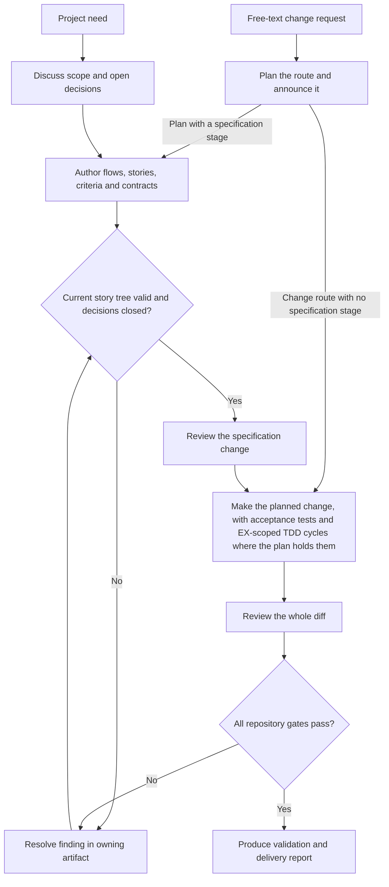

# BF-0001: Develop and verify a QFAI project

## Purpose

Take a project need through discussion, story and contract authoring,
implementation with its acceptance tests, verification and a report. The
current story tree and contracts are the execution source; discussion records
the decisions that led to them.

## Flow

## Alternate and exception paths

- Missing usable discussion source stops SDD until the source is supplied.
- An open product decision returns to discussion and SDD before implementation.
- UI-bearing work, including CLI-only interactions, requires screen contracts.
  A visual prototyping surface also requires root `DESIGN.md` and a
  user-confirmed prototype. A CLI-only surface requires neither `DESIGN.md`
  nor a visual prototype.
- When a reviewed specification change needs visual prototyping, the change is
  prototyped until the user confirms the prototype, and only then implemented.
  Work that needs no visual prototyping goes from the specification review
  straight to implementation.
- A failed validation, review or gate returns to the artifact that owns the
  finding. Completion is reported only after the relevant gate passes.
- A free-text change request in mode `active` is planned by `qfai-run` with
  `npx qfai workflow plan`, and the session follows the planned stages with no
  stage typed by the user. A critical decision and each release point wait for
  the user's approval. An example a defect repair needs, which conflicts with
  nothing in the specification, is appended under its existing criterion
  without asking; one that would conflict waits for the user's answer. Text
  that is not a request, or a mode of `off` or `shadow`, is not planned.
- Fixed decision rules choose the route from the facts read out of the request.
  A request that needs no change runs a route that answers, closes, splits or
  hands it back and changes no product file. Its only tracked writes are the
  run's deliberation record and the `open-questions.md` rows the run wrote,
  which its last step commits locally without pushing, and an approval row
  `qfai-run` records in `decisions.md` before a hand-off. A diagnosis showing
  the work is on the wrong route moves it, at a branch point the route declares,
  to the route that fits.
- A plan ending at `triage-close` answers, closes or hands over the request
  and reaches no implementation.
- The `draft-release-notes` route drafts the release notes and asks the user
  for the release approval.
- A request to write the acceptance tests of a flow runs the quality-phase
  route, which writes the bodies of the empty acceptance tests.
- A scope change discovered after an accepted implementation item follows the
  drift protocol through SDD before another item is selected.
- Graph exploration uses project-local CodeGraph and Graphify CLIs. Their
  integration registers and launches no MCP server; unrelated project MCP
  settings remain intact.
