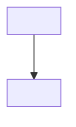

# Technology

## Stack

| Component           | Choice                                |
| ------------------- | ------------------------------------- |
| Runtime             | `<example: Node.js 22>`               |
| Platform            | `<example: Linux, macOS and Windows>` |
| Surface             | `<example: cli>`                      |
| CI                  | `<example: GitHub Actions>`           |
| Language            | `<example: TypeScript 5>`             |
| Package manager     | `<example: pnpm 9>`                   |
| Build tool          | `<example: tsup>`                     |
| Test runner         | `<example: Vitest>`                   |
| Lint / format       | `<example: ESLint and Prettier>`      |
| CSS framework       | `<example: none>`                     |
| Component catalogue | `<example: none>`                     |

## Architecture

| Layer               | Responsibility                                                 | Depends on      |
| ------------------- | -------------------------------------------------------------- | --------------- |
| <example: Commands> | <example: Parses the arguments of each command and calls Core> | <example: Core> |
| <example: Core>     | <example: Reads and checks the project files>                  | -               |

## Dependencies

- `<example: yaml>`
  - <example: Parses the configuration file.>

## Standard commands (copy-paste)

- Install: `<example: pnpm install --frozen-lockfile>`
- Format: `<example: pnpm prettier --check .>`
- Test: `<example: pnpm vitest run>`
- Lint: `<example: pnpm eslint .>`
- Typecheck: `<example: pnpm tsc --noEmit>`
- Build: `<example: pnpm build>`
- Skeleton: `<example: node dist/cli.js --help>`
- Validate: `<example: npx qfai validate>`
- Pack / distribution: `<optional example: pnpm pack --dry-run>`
- Turn-end check: `<optional example: Format, Lint, Typecheck>`
